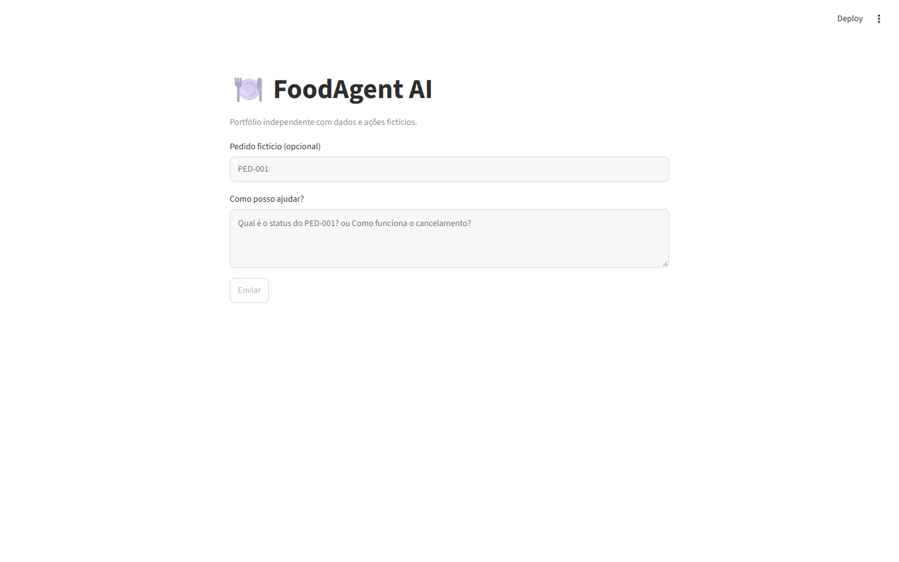
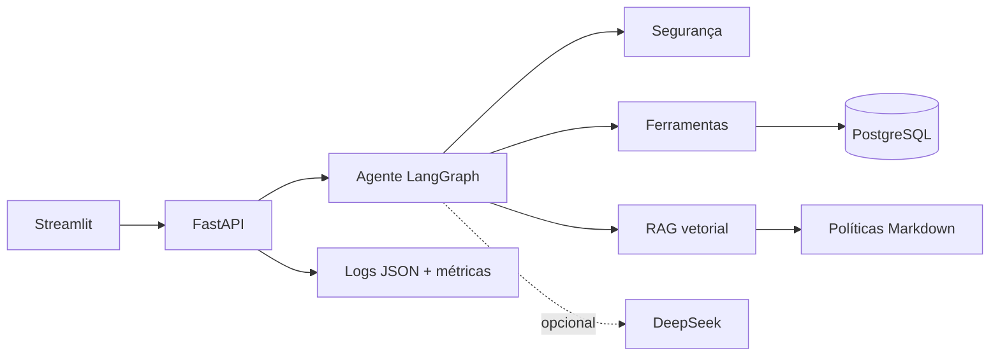

# FoodAgent AI

[](https://github.com/igortavares2709-ops/foodagent-ai/actions/workflows/tests.yml)
[](https://github.com/igortavares2709-ops/foodagent-ai/actions/workflows/container.yml)

Agente inteligente de atendimento de delivery construído como portfólio de
AI Builder e AI Engineering. Combina visão de produto, automação, experiência
do usuário, FastAPI, PostgreSQL, RAG, LangGraph, avaliação, segurança,
observabilidade, Streamlit e Docker.

Projeto independente, com dados e ações fictícios, sem vínculo oficial com o iFood.

## Visão AI Builder

O projeto transforma uma jornada recorrente de atendimento em um protótipo
funcional: entende a necessidade, consulta dados ou políticas, explica a
resposta e encaminha ações sensíveis para revisão humana. A implementação
prioriza experiência demonstrável, automação segura, métricas de qualidade e
continuidade mesmo sem disponibilidade do provedor de LLM.

Veja o [case de produto e automação](docs/case-ai-builder.md), com oportunidade,
jornada, proposta de valor, métricas, limites e próximos experimentos.

## Demo pública

- [Interface Streamlit](https://foodagent-ai-igortavares2709.onrender.com)
- [API e documentação OpenAPI](https://foodagent-api-igortavares2709.onrender.com/docs)

> Os serviços usam o plano gratuito do Render. O primeiro acesso após um período
> sem uso pode levar alguns segundos enquanto a instância é iniciada.



## Demonstrações

- Consultar o status de `PED-001` no PostgreSQL.
- Responder políticas fictícias com RAG e citar as fontes.
- Simular cancelamento sem alterar dados.
- Encaminhar ações sensíveis para revisão humana.
- Recusar tentativas simples de revelar prompt ou segredos.
- Executar sem saldo da DeepSeek, usando fallback determinístico.

## Arquitetura



Detalhes em [Arquitetura](docs/arquitetura.md).

## Endpoints

| Método | Rota | Finalidade |
|---|---|---|
| GET | `/health` | Saúde do processo |
| GET | `/metrics` | Contadores básicos |
| GET | `/pedidos/{id}` | Consulta pedido fictício |
| POST | `/chat` | Conversa com o agente |
| POST | `/acoes/cancelamento` | Simulação sem efeito real |
| GET | `/docs` | OpenAPI interativo |

## Execução local no Windows

Requisitos: Python 3.14, PostgreSQL 17 e Git.

```powershell
py -3.14 -m venv .venv
```

```powershell
.\.venv\Scripts\python.exe -m pip install -r requirements-dev.txt
```

```powershell
Copy-Item .env.example .env
```

Configure `DB_PASSWORD` somente no `.env`. Crie `foodagent_app` sem
privilégios administrativos, crie o banco `foodagent` e execute
[sql/001_criar_pedidos.sql](sql/001_criar_pedidos.sql) como `postgres`.

```powershell
.\.venv\Scripts\python.exe -m uvicorn api:app --reload --host 127.0.0.1 --port 8000
```

Em outro terminal:

```powershell
.\.venv\Scripts\streamlit.exe run app_streamlit.py
```

- API: http://127.0.0.1:8000/docs
- Interface: http://127.0.0.1:8501

## Exemplo de chat

```powershell
$body = @{ mensagem = "Como funciona atraso na entrega?" } | ConvertTo-Json
Invoke-RestMethod -Method Post -Uri http://127.0.0.1:8000/chat -ContentType application/json -Body $body
```

A resposta contém texto, intenção, fontes, indicação de revisão humana e request ID.

## DeepSeek

A geração por LLM é opcional. Para habilitar, defina no `.env`:

```dotenv
DEEPSEEK_ENABLED=true
DEEPSEEK_API_KEY=
```

Sem chave, saldo ou disponibilidade, o RAG usa um fallback determinístico.
Nenhum teste automatizado consome créditos. Nunca versione a chave.

## Testes e avaliação

Testes sem banco real:

```powershell
.\.venv\Scripts\python.exe -m pytest -q
```

Suíte completa, com `foodagent_test` preparado:

```powershell
.\.venv\Scripts\python.exe -m pytest -q --integration
```

Avaliação funcional:

```powershell
.\.venv\Scripts\python.exe avaliar.py
```

Validação local mais recente: **53 testes aprovados** e **4/4 cenários de
avaliação aprovados**. A CI repete testes unitários e de integração em um
PostgreSQL 17 efêmero. Veja [testes PostgreSQL](docs/testes-postgresql.md).

## Docker

```powershell
docker compose up --build
```

O Compose inicia PostgreSQL, API e Streamlit. Credenciais declaradas nele são
fictícias e exclusivas do ambiente local. A imagem também é publicada no GHCR
pela CI. Consulte [deploy](docs/deploy.md).

## Decisões de engenharia

- Dependências do FastAPI permitem substituir repositórios nos testes.
- SQL parametrizado e usuário de banco com privilégio mínimo.
- RAG local com embedding por hashing normalizado e fontes rastreáveis.
- LangGraph torna roteamento e nós do agente explícitos.
- DeepSeek opcional com timeout, erros controlados e fallback.
- Logs não armazenam o corpo das mensagens.
- Request IDs conectam cliente, resposta e logs.
- Banco de integração separado e protegido por validação de nome.

## Estrutura

```text
api.py                  API e endpoints
agente.py               grafo LangGraph
rag.py                   recuperação e embeddings
ferramentas.py           ferramentas e ações simuladas
repositorio_postgres.py  persistência
seguranca.py             guardrails e mascaramento
observabilidade.py       logs e métricas
app_streamlit.py         interface
evals/                   conjunto de avaliação
tests/                   testes unitários e de integração
docs/                    arquitetura, segurança e deploy
sql/                     preparação dos bancos
```

## Limites conhecidos

Este é um portfólio, não um serviço de produção. O embedding local prioriza
reprodutibilidade e baixo custo; produção exigiria comparação com modelos
semânticos. Métricas são locais ao processo. Autenticação, autorização,
rate limiting distribuído, migrations completas, pool de conexões, secret
manager e testes de carga são evoluções de produção.

## Documentação

- [Arquitetura](docs/arquitetura.md)
- [Avaliação, segurança e observabilidade](docs/avaliacao-seguranca.md)
- [Testes PostgreSQL](docs/testes-postgresql.md)
- [Deploy](docs/deploy.md)
- [Apresentação do portfólio](docs/apresentacao-github.md)

## Licença

MIT. Consulte [LICENSE](LICENSE).
