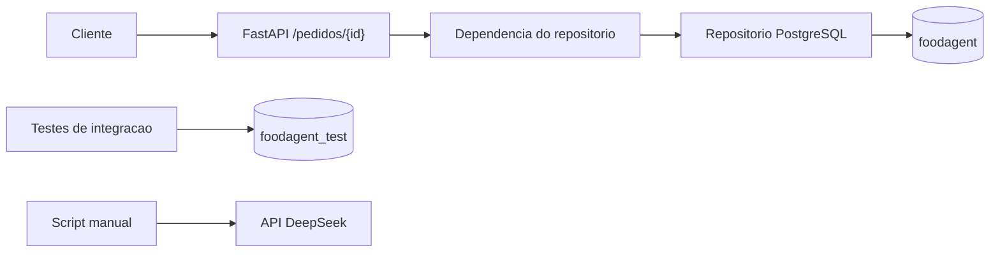

# FoodAgent AI

Agente de atendimento de delivery em desenvolvimento, com Python, FastAPI,
PostgreSQL e integracao DeepSeek. Projeto independente de portfolio voltado a
demonstrar competencias de AI Engineering em cenarios de delivery.
Sem vinculo oficial com o iFood.

## O que funciona hoje

- API local com documentacao OpenAPI interativa.
- Consulta de pedidos ficticios persistidos em PostgreSQL.
- Validacao de identificadores, resposta 404 e tratamento de indisponibilidade 503.
- Usuario da aplicacao com permissao de leitura, sem superusuario.
- Cliente DeepSeek com timeout, SQL separado de parametros no repositorio,
  tratamento de falhas HTTP e testes simulados sem consumo de creditos.
- Configuracao por variaveis de ambiente; exemplos sem segredos.
- Testes unitarios, testes de API isolados e integracao real com banco separado.
- Workflow de CI com PostgreSQL efemero.

## Arquitetura atual



A DeepSeek ainda nao e chamada pela rota de pedidos. O agente, o RAG e as acoes
simuladas fazem parte das proximas etapas; nao sao apresentados como implementados.

## Executar no Windows

Requisitos: Python 3.14, Git e PostgreSQL 17. O projeto foi desenvolvido no Windows.
Execute cada comando separadamente no PowerShell, na raiz do repositorio.

```powershell
py -3.14 -m venv .venv
```

```powershell
.\.venv\Scripts\python.exe -m pip install -r requirements-dev.txt
```

Se ainda nao existir .env:

```powershell
Copy-Item .env.example .env
```

Edite .env localmente. Configure DB_PASSWORD com a senha de foodagent_app.
Nunca versione esse arquivo. A chave DeepSeek pode permanecer vazia para usar
a API de pedidos e os testes.

No pgAdmin, crie o usuario foodagent_app com login e sem privilegios administrativos.
Crie o banco foodagent com owner postgres. Conectado a foodagent como postgres,
execute sql/001_criar_pedidos.sql uma vez. Mais detalhes em
[Configuracao dos testes PostgreSQL](docs/testes-postgresql.md).

Inicie a API:

```powershell
.\.venv\Scripts\python.exe -m uvicorn api:app --reload --host 127.0.0.1 --port 8000
```

- Documentacao: http://127.0.0.1:8000/docs
- Saude do processo: http://127.0.0.1:8000/health
- Pedido existente: http://127.0.0.1:8000/pedidos/PED-001
- Pedido inexistente: http://127.0.0.1:8000/pedidos/PED-999

/health confirma o processo, nao a disponibilidade do banco. Para parar, use Ctrl+C.

## Testes

Sem depender do banco:

```powershell
.\.venv\Scripts\python.exe -m pytest -q
```

Com o banco de testes previamente preparado:

```powershell
.\.venv\Scripts\python.exe -m pytest -q --integration
```

A etapa atual foi validada localmente com **36 testes aprovados**:
29 sem banco e 7 de integracao PostgreSQL. A execucao padrao ignora explicitamente
os 7 testes reais. Veja [instrucoes e protecoes](docs/testes-postgresql.md).

## DeepSeek

testar_deepseek.py realiza uma chamada real e pode consumir creditos.
A chave deve existir somente no .env ou no ambiente do processo.
A integracao real ja retornou erro controlado de saldo insuficiente;
a geracao real de uma resposta ainda depende de creditos na conta.
Os testes automatizados nao acessam a DeepSeek.

## Decisoes de engenharia

- Modelos de resposta separados em schemas.py.
- Repositorios separados das rotas e substituiveis por dependencia.
- SQL parametrizado para entradas externas.
- Erros internos e credenciais nao aparecem nas respostas da API.
- Banco de testes separado, com validacao explicita do destino.
- Dados e acoes exclusivamente ficticios.

## Proximas etapas

- Ferramentas para consultar pedidos e simular acoes.
- RAG com politicas ficticias, embeddings e recuperacao.
- Orquestracao do agente com LangGraph.
- Avaliacao de respostas, seguranca e observabilidade.
- Docker, interface Streamlit, deploy e documentacao final.

Ainda nao e um servico de producao: autenticacao, limites de uso, migrations,
pool de conexoes e deploy serao tratados em etapas posteriores.
