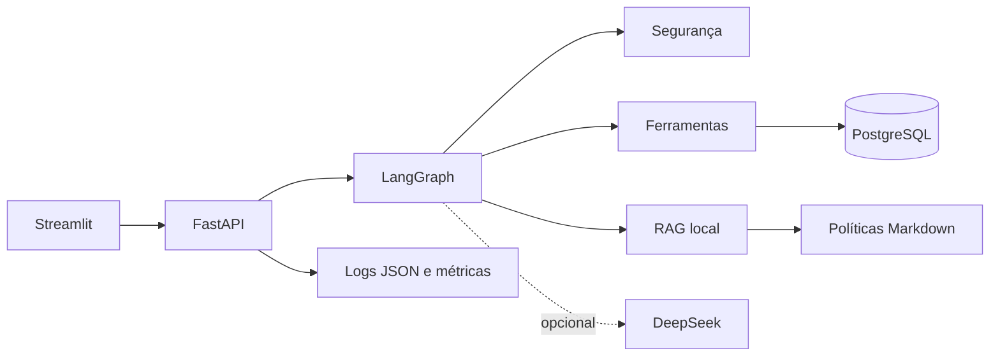

# Arquitetura

O FoodAgent AI separa transporte HTTP, orquestração, ferramentas e persistência.

## Fluxos

- Pedido: identifica PED-000, consulta SQL parametrizado e responde com fonte.
- Política: recupera trechos por similaridade vetorial; DeepSeek é opcional.
- Ação sensível: não altera dados e exige revisão humana.
- Segurança: bloqueia instruções para revelar prompts e mascara PII.
- Falha da DeepSeek: usa resposta baseada no contexto recuperado.
- Falha do banco: API retorna 503 sem detalhes internos.

O embedding local usa hashing normalizado com 256 dimensões. Ele é leve,
reproduzível e adequado à demonstração, mas deve ser substituído por embeddings
semânticos avaliados para produção.
